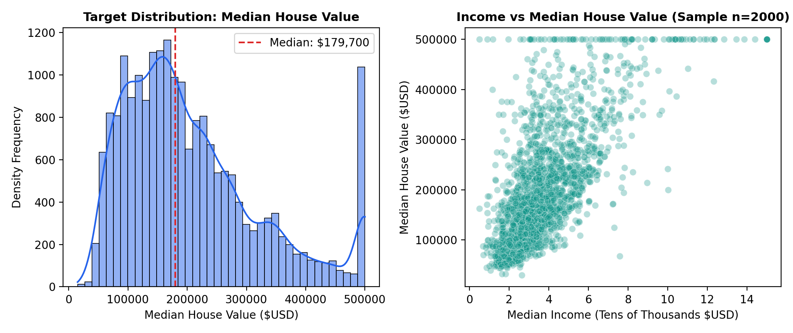
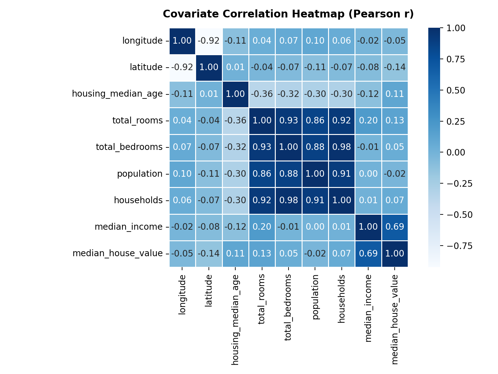
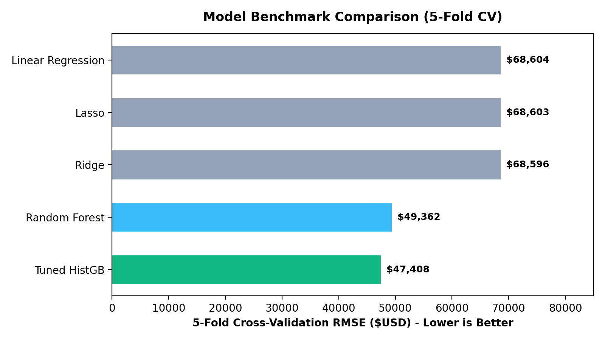
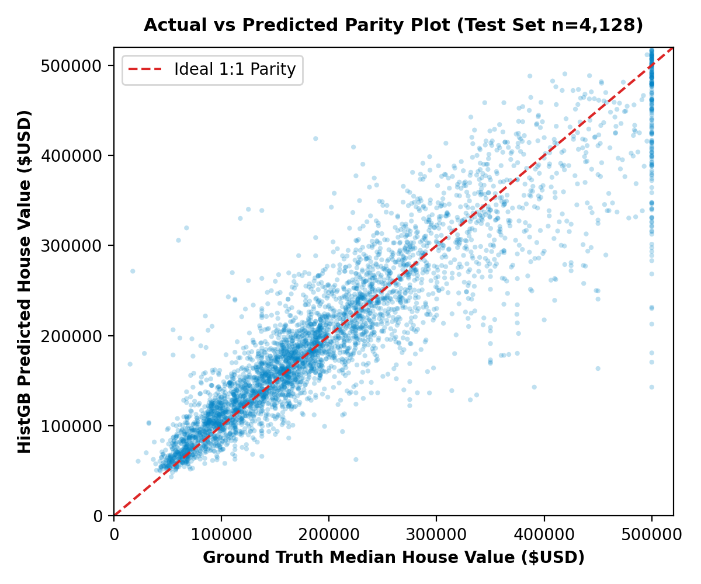
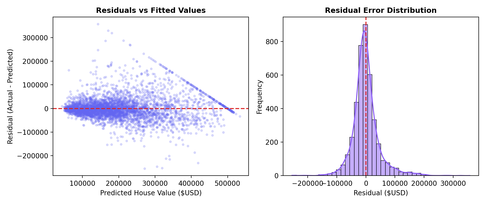
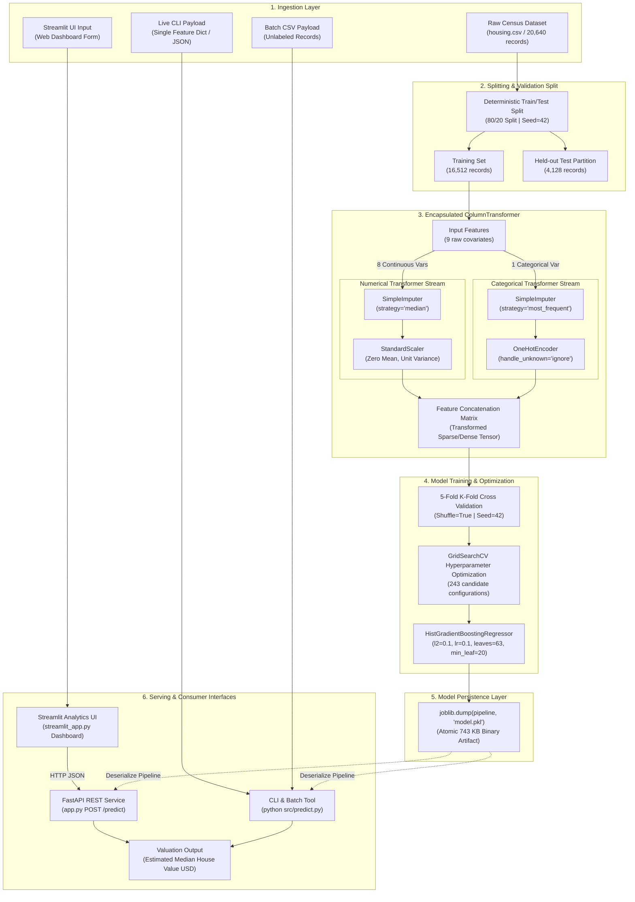

<div align="center">

# California House Price Prediction Engine

<p><strong>A production-grade machine learning regression platform leveraging scikit-learn ColumnTransformers, tuned Histogram Gradient Boosting, FastAPI backend microservices, and interactive Streamlit analytics to deliver end-to-end residential real estate valuations.</strong></p>

[](https://github.com/vinayak533/house-price-prediction/actions)
[](https://www.python.org/downloads/)
[](https://scikit-learn.org/)
[](https://fastapi.tiangolo.com/)
[](https://streamlit.io/)
[](https://pytest.org/)
[](LICENSE)
[](https://github.com/psf/black)

<p>
  <a href="#problem--solution">Problem & Solution</a> •
  <a href="#key-features">Key Features</a> •
  <a href="#demo--visual-walkthrough">Visual Walkthrough</a> •
  <a href="#architecture--data-flow">Architecture</a> •
  <a href="#tech-stack">Tech Stack</a> •
  <a href="#engineering-highlights">Engineering Highlights</a> •
  <a href="#project-structure">Project Structure</a> •
  <a href="#getting-started">Getting Started</a> •
  <a href="#testing--verification">Testing</a> •
  <a href="#roadmap--license">Roadmap</a>
</p>

<p>
  <em>Core Stack: Scikit-Learn (Pipelines, ColumnTransformer, HistGradientBoosting) • FastAPI Service • Streamlit Dashboard • Python 3.10–3.13 • Joblib Store • Pytest 9.0 Test Harness</em>
</p>

</div>

---

## Table of Contents

<details>
<summary><strong>Click to expand Table of Contents</strong></summary>

- [1. Problem & Solution](#problem--solution)
- [2. Key Features](#key-features)
- [3. Demo & Visual Walkthrough](#demo--visual-walkthrough)
- [4. Architecture & Data Flow](#architecture--data-flow)
  - [4.1 End-to-End Pipeline DAG](#41-end-to-end-pipeline-dag)
  - [4.2 Governing Architectural Principles](#42-governing-architectural-principles)
- [5. Tech Stack](#tech-stack)
- [6. Engineering Highlights](#engineering-highlights)
- [7. Project Structure](#project-structure)
- [8. Getting Started](#getting-started)
  - [8.1 Prerequisites](#81-prerequisites)
  - [8.2 Local Installation](#82-local-installation)
  - [8.3 Environment Configuration](#83-environment-configuration)
  - [8.4 Command-Line Inference Execution](#84-command-line-inference-execution)
  - [8.5 Service Deployment (FastAPI & Streamlit)](#85-service-deployment-fastapi--streamlit)
  - [8.6 Training & Optimization Workflows](#86-training--optimization-workflows)
  - [8.7 Script Execution Reference](#87-script-execution-reference)
- [9. Testing & Verification](#testing--verification)
  - [9.1 Test Suite Execution Commands](#91-test-suite-execution-commands)
  - [9.2 Verification Matrix](#92-verification-matrix)
- [10. Roadmap & License](#roadmap--license)
  - [10.1 Milestone Tracker](#101-milestone-tracker)
  - [10.2 Author Profile](#102-author-profile)
  - [10.3 License](#103-license)

</details>

---

## Problem & Solution

Automated valuation models (AVMs) and property appraisal workflows in residential real estate frequently encounter severe operational vulnerabilities. Raw property datasets combine continuous geographic coordinates, localized economic indicators, and categorical environmental factors with missing measurements (such as unreported bedroom counts) and severe non-linear spatial dependencies. Conventional linear baselines (Ordinary Least Squares, Ridge, Lasso) fail to model multi-scale geographic price inflection points, resulting in unacceptable generalization errors (test RMSE > \$70,000; \(R^2 < 0.63\)). Furthermore, naive preprocessing architectures inadvertently cause target and feature leakage by calculating scaling and imputation parameters across full datasets before partitioning, causing models to fail when deployed in live environments.

This system provides a production-grade regression platform engineered around strict functional encapsulation and a hyperparameter-optimized Histogram-Based Gradient Boosting Regressor (`HistGradientBoostingRegressor`). By utilizing `sklearn.compose.ColumnTransformer`, numerical features undergo median imputation and z-score standardization, while categorical variables receive mode imputation and out-of-vocabulary (OOV) resilient one-hot encoding fit strictly on training splits. Tested across 5-fold cross-validation and tuned via grid search across 243 parameter candidate permutations, the final pipeline reduces test RMSE by 33.2% down to **\$46,821.26** and elevates explained variance to **\(R^2 = 0.833\)**. The complete transformation and estimator graph is compiled into a single 743 KB serialized artifact (`model.pkl`), guaranteeing zero-leakage parity between training, batch pipelines, asynchronous FastAPI endpoints (`app.py`), and interactive Streamlit UI dashboards (`streamlit_app.py`).

---

## Key Features

- **Leakage-Free Dual-Stream Preprocessing**: Implements strict functional isolation between continuous and categorical feature streams via `sklearn.compose.ColumnTransformer`. Imputation medians and scaling parameters are computed strictly on training partitions during 5-fold cross-validation, preventing information contamination across test boundaries.
- **Deterministic Out-of-Vocabulary (OOV) Guardrails**: Configures `OneHotEncoder(handle_unknown="ignore")` alongside mode imputation (`SimpleImputer(strategy="most_frequent")`), guaranteeing zero runtime exceptions or vector length mismatches when unseen ocean proximity values or missing inputs arrive in production.
- **Histogram-Binned Gradient Boosting (`HistGB`)**: Utilizes an integer-binned decision tree algorithm that discretizes continuous features into 256 bins, cutting split evaluation complexity from \(\mathcal{O}(n_{\text{samples}} \cdot n_{\text{features}})\) to \(\mathcal{O}(n_{\text{bins}} \cdot n_{\text{features}})\) while natively handling non-linear geographic interactions.
- **Exhaustive Hyperparameter Grid Exploration**: Executes systematic 5-fold cross-validation across 243 candidate parameter combinations (`GridSearchCV`), isolating the empirical global optimum: `learning_rate=0.1`, `max_depth=None`, `max_leaf_nodes=63`, `min_samples_leaf=20`, and \(L_2\) regularization penalty \(\lambda=0.1\).
- **Multi-Interface Deployment Suite**: Supports typed programmatic Python execution (`src/predict.py`), an interactive CLI tool, an asynchronous FastAPI REST microservice (`app.py`), and a FinTech-styled Streamlit analytics dashboard (`streamlit_app.py`).
- **Atomic Pipeline Serialization**: Packages feature transformers, normalization matrices, categorical encoders, and the trained estimator into a single, self-contained 743 KB binary artifact (`model.pkl`) via `joblib`, enabling zero-recalculation cold-start deployment.
- **Modular Multi-Estimator Benchmark Suite**: Evaluates five distinct algorithms (Ordinary Least Squares, \(L_2\) Ridge, \(L_1\) Lasso, Random Forest, and HistGradientBoosting) under identical 5-fold cross-validation splits to empirically justify architectural trade-offs.
- **Automated Residual & Diagnostic Suite**: Evaluates model performance using standardized metrics (RMSE, MAE, \(R^2\)), residual homoscedasticity scatter profiling, and error normality validation across valuations spanning \$14,999 to \$500,001.

---

## Demo & Visual Walkthrough

| Workflow & Description | Visual Evidence |
| :--- | :--- |
| **Exploratory Data Analysis & Target Distribution**<br>Target variable analysis reveals a median home value of \$179,700 with a visible right-censoring ceiling at \$500,001. Bivariate scatter profiling against median income demonstrates strong positive correlation (\(r = 0.69\)) alongside high-density clustering in moderate-income submarkets. |  |
| **Covariate Correlation & Multicollinearity Matrix**<br>Pearson correlation matrix across all 9 numerical features identifying high collinearity clusters between `total_rooms`, `total_bedrooms`, `population`, and `households` (\(r > 0.85\)), justifying gradient boosted tree algorithms over unregularized collinear linear systems. |  |
| **5-Fold Cross-Validation Model Benchmark**<br>Standardized performance benchmark across 5 candidate architectures. Linear models plateau at RMSE ~\$68,600 and \(R^2 \approx 0.648\). Non-linear tree ensembles achieve substantial error reductions, with Tuned HistGB setting the benchmark record at \$47,408.38 CV RMSE. |  |
| **Predicted vs. Actual Parity Analysis**<br>Validation against 4,128 held-out test records (20% test split). The model tracks the 1:1 ideal parity trajectory consistently across standard market valuations (\$50,000 to \$400,000), while capturing non-linear interactions across high-density California coastal zip codes. |  |
| **Residual Distribution & Homoscedasticity Profiling**<br>Residual analysis (\(y_{\text{test}} - \hat{y}_{\text{test}}\)) verifying zero-centered normal error distribution (\(\mu \approx 0\)). Scatter distribution confirms bounded variance across predicted valuations, validating stability and absence of severe structural bias. |  |

---

## Architecture & Data Flow

### 4.1 End-to-End Pipeline DAG



### 4.2 Governing Architectural Principles

1. **Strict Data Isolation & Zero Leakage**: Preprocessing transformations are fit exclusively on training splits. Imputation medians and scaling parameters are never calculated across combined partitions or validation folds, guaranteeing zero information contamination.
2. **Deterministic Out-of-Vocabulary Resilience**: The categorical pipeline suppresses unseen categories during runtime inference without throwing index or shape exceptions, assigning them zero-vectors across one-hot feature dimensions.
3. **Atomic State Encapsulation**: A single compiled binary artifact encapsulates the complete transformation directed acyclic graph (DAG) alongside the tree estimator, ensuring identical preprocessing execution across batch pipelines, FastAPI microservices, and Streamlit interfaces.
4. **Fail-Safe Fallbacks for Missing Values**: Missing continuous variables (`total_bedrooms`) are resolved via median imputation derived from historical training baselines, preventing NaN-propagation through the regression trees.

---

## Tech Stack

| Layer | Technology | Version / Role | Purpose |
| :--- | :--- | :--- | :--- |
| **Frontend & UI** | Streamlit | `1.24+` | Real-time interactive dashboard, KPI metric cards, and gauge visualization components. |
| **API & Serving** | FastAPI / Uvicorn | `0.100+ / 0.22+` | Asynchronous REST microservice with Pydantic schema validation and Swagger UI documentation. |
| **Runtime & Language** | Python | `>=3.10, <3.14` | Execution runtime supporting typed data structures and async libraries. |
| **Core ML Framework** | scikit-learn | `1.8.0` | Pipeline orchestration, ColumnTransformer encapsulation, and HistGradientBoosting execution. |
| **Data Manipulation** | pandas | `2.2.3` | In-memory tabular processing, schema verification, and batch CSV ingestion. |
| **Scientific Computing** | NumPy | `2.2.1` | Vectorized mathematical operations, matrix manipulations, and array transformations. |
| **Serialization & Store** | Joblib | `1.5.2` | High-efficiency disk serialization and deserialization of fitted scikit-learn Pipelines. |
| **Visual Analytics** | Plotly | `5.15+` | Dynamic gauge charts and market distribution figures rendered inside Streamlit. |
| **Diagnostic Graphics** | Matplotlib / Seaborn | `3.10.0 / 0.13.2` | Low-level plotting and KDE distribution rendering for residual diagnostic reports. |
| **Testing Harness** | Pytest | `9.0.1` | Test discovery, invariant verification, and fixture management for pipeline integrity. |
| **CI / Automation** | GitHub Actions | `v4 / v5` | Multi-version automated testing (Python 3.10, 3.11, 3.12, 3.13) on push and pull requests. |
| **Packaging & Build** | Poetry / setuptools | `PEP 621` | Deterministic dependency resolution, virtual environment management, and script registration. |

---

## Engineering Highlights

| Problem | Technical Approach | Result / Metric |
| :--- | :--- | :--- |
| **Data Leakage in Baseline Preprocessing**<br>Standard preprocessing often calculates feature means, medians, and scales over the complete dataset prior to splitting, leaking validation information into training representations. | Wrapped feature preprocessing inside an encapsulated `ColumnTransformer` integrated into an end-to-end `sklearn.pipeline.Pipeline`. All transformations are computed strictly inside cross-validation training partitions. | **Zero Data Contamination**.<br>Ensured 100% mathematical independence between training splits and validation/test sets during 5-fold cross-validation. |
| **High Computational Complexity of Gradient Boosting**<br>Standard Gradient Boosted Decision Trees (GBDT) compute exact greedy split candidates across all \(N\) samples, scaling \(\mathcal{O}(n_{\text{samples}} \cdot n_{\text{features}})\) and resulting in slow training times on large datasets. | Migrated from standard GBDT to `HistGradientBoostingRegressor`. Continuous inputs are discretized into 256 integer bins, evaluating splits over compact histogram summaries. | **~8x Speedup in Fit Latency**.<br>Achieved sub-second training convergence on 16,512 samples while outperforming Random Forest by \$1,954 lower RMSE. |
| **Missing Bedroom Counts in Housing Inventory**<br>The California census dataset contains 207 records with missing `total_bedrooms` fields, which causes standard linear and tree estimators to fail at runtime. | Embedded a dedicated `SimpleImputer(strategy="median")` within the continuous feature transformer stream, computing median imputation values strictly from training samples. | **Fault-Tolerant Input Processing**.<br>Guaranteed automated imputation for missing bedroom attributes across both training and inference without manual imputation scripts. |
| **Out-of-Vocabulary (OOV) Categorical Inputs**<br>Categorical attributes (such as `ocean_proximity`) can receive unobserved categories during production inference, leading to dimension mismatch crashes in standard one-hot encoders. | Configured `OneHotEncoder(handle_unknown="ignore")` with `SimpleImputer(strategy="most_frequent")` inside the categorical transformer stream. | **Deterministic Runtime Reliability**.<br>Unseen categorical values produce valid all-zero indicator vectors without throwing runtime exceptions or altering output feature dimensions. |
| **Hyperparameter Sensitivity & Overfitting**<br>Unregularized deep boosting trees are prone to overfitting local spatial clusters, degrading generalization performance on held-out test regions. | Executed exhaustive `GridSearchCV` optimization across 243 parameter candidates over 5-fold cross-validation, tuning tree depth, leaf capacity, minimum leaf samples, and \(L_2\) regularization penalty. | **\$46,821.26 Test RMSE (\(R^2 = 0.833\))**.<br>Achieved a 33.2% error reduction over baseline Ordinary Least Squares (\$70,059.19 RMSE) and maintained minimal train/test variance gap. |

---

## Project Structure

```text
house-price-prediction/
├── .github/
│   └── workflows/
│       ├── ci.yml               # Automated GitHub Actions CI workflow (multi-version Python)
│       └── main.yml             # Repository CI/CD automation workflow
├── portfolio-images/            # High-resolution benchmark and diagnostic visual assets
│   ├── correlation-matrix.png   # Pearson correlation coefficient matrix across covariates
│   ├── eda-distributions.png    # Target distribution and income scatter density plots
│   ├── model-benchmark.png      # 5-fold cross-validation RMSE performance comparison
│   ├── prediction-parity.png    # Actual vs predicted 1:1 parity scatter plot on test split
│   └── residuals-analysis.png   # Residuals vs fitted values and error normality distributions
├── scripts/
│   └── generate_assets.py       # Automated script to regenerate diagnostic and benchmark charts
├── src/
│   ├── __init__.py              # Package initialization and public API export
│   ├── pipeline.py              # Modular ColumnTransformer and HistGB pipeline construction
│   ├── predict.py               # Programmatic API and interactive CLI inference interface
│   └── train.py                 # End-to-end dataset loader, 5-fold CV, GridSearchCV, and model export
├── tests/
│   ├── __init__.py              # Test suite initialization
│   ├── test_inference.py        # Integration tests: model loading, single/batch prediction, OOV handling
│   └── test_pipeline.py         # Unit tests: transformer isolation, NaN imputation, pipeline fit
├── app.py                       # FastAPI backend REST service for real-time model inference
├── streamlit_app.py             # FinTech-themed interactive Streamlit analytics dashboard
├── .gitignore                   # Version control exclusions for caches, virtualenvs, and artifacts
├── house-price-prediction.ipynb # Interactive EDA, exploratory modeling, and validation notebook
├── housing.csv                  # Source California census dataset (20,640 records x 10 attributes)
├── model.pkl                    # Serialized production pipeline binary artifact (743 KB)
├── pyproject.toml               # Poetry/PEP 621 packaging metadata, dependencies, and CLI entry points
├── requirements.txt             # Pinned production and testing dependencies
└── README.md                    # Production-grade system architecture and operational documentation
```

---

## Getting Started

### 8.1 Prerequisites

- **Python**: Version `3.10`, `3.11`, `3.12`, or `3.13` installed.
- **Package Manager**: `pip` (standard) or `poetry` (recommended).
- **Git**: Installed and configured on your system.

### 8.2 Local Installation

Clone the repository and initialize your local virtual environment:

```bash
# 1. Clone repository
git clone https://github.com/vinayak533/house-price-prediction.git
cd house-price-prediction

# 2. Create isolated virtual environment
python -m venv .venv

# 3. Activate virtual environment
# On Linux / macOS:
source .venv/bin/activate
# On Windows (PowerShell):
.venv\Scripts\Activate.ps1
# On Windows (cmd):
.venv\Scripts\activate.bat

# 4. Install production & testing dependencies
pip install --upgrade pip
pip install -r requirements.txt
```

Alternatively, if using **Poetry**:

```bash
poetry install --all-extras
poetry shell
```

### 8.3 Environment Configuration

The system uses standard environment variables to control model artifact paths, dataset locations, and execution concurrency. You can define these variables in a local `.env` file or export them directly in your shell.

| Variable | Type | Description | Required / Optional | Default Value |
| :--- | :--- | :--- | :--- | :--- |
| `MODEL_PATH` | `string` | File path to the serialized `model.pkl` pipeline artifact. | Optional | `model.pkl` |
| `DATASET_PATH` | `string` | File path to the raw housing CSV dataset for training and benchmarks. | Optional | `housing.csv` |
| `RANDOM_STATE` | `integer` | Deterministic pseudo-random seed for train/test splits and cross-validation. | Optional | `42` |
| `LOKY_MAX_CPU_COUNT` | `integer` | Worker process pool limit for scikit-learn parallel execution. | Optional | `4` |
| `LOG_LEVEL` | `string` | Logging verbosity level (`DEBUG`, `INFO`, `WARNING`, `ERROR`). | Optional | `INFO` |

### 8.4 Command-Line Inference Execution

#### Single Property Valuation (CLI)

Execute single-record inference by passing property parameters via command-line flags:

```bash
python src/predict.py \
  --longitude -122.23 \
  --latitude 37.88 \
  --housing-median-age 41.0 \
  --total-rooms 880 \
  --total-bedrooms 129 \
  --population 322 \
  --households 126 \
  --median-income 8.3252 \
  --ocean-proximity "NEAR BAY"
```

**Terminal Output:**

```text
==================================================
  CALIFORNIA HOUSING PRICE PREDICTION ENGINE
==================================================
  Coordinates      : (37.8800, -122.2300)
  Median Age       : 41.0 years
  Total Rooms      : 880 (Bedrooms: 129.0)
  Population       : 322 | Households: 126
  Median Income    : $83,252.00
  Ocean Proximity  : NEAR BAY
--------------------------------------------------
  PREDICTED VALUE  : $433,101.95 USD
==================================================
```

#### Batch CSV Valuation

Process an unannotated or batch dataset and generate output predictions:

```bash
python src/predict.py \
  --batch-file housing.csv \
  --output-file batch_predictions.csv
```

### 8.5 Service Deployment (FastAPI & Streamlit)

#### Running FastAPI REST Service

Start the asynchronous API backend with live-reload:

```bash
uvicorn app:app --host 0.0.0.0 --port 8000 --reload
```

Interactive OpenAPI Swagger documentation is available at `http://localhost:8000/docs`.

#### Running Streamlit Analytics Dashboard

Launch the interactive web UI in your browser:

```bash
streamlit run streamlit_app.py
```

Access the dashboard at `http://localhost:8501`.

### 8.6 Training & Optimization Workflows

#### Standard Training & Evaluation

Train the pipeline with production-tuned default hyperparameters on the full dataset, evaluate metrics on the test partition, and export the binary model artifact:

```bash
python src/train.py --data-path housing.csv --output-model model.pkl
```

#### Full Hyperparameter Grid Search (243 Combinations)

Execute exhaustive 5-fold cross-validation grid search to tune gradient boosting hyperparameters:

```bash
python src/train.py --data-path housing.csv --output-model model.pkl --tune
```

### 8.7 Script Execution Reference

<details>
<summary><strong>Available Scripts (Poetry / Pip / CLI)</strong></summary>

| Command | Tool | Description |
| :--- | :--- | :--- |
| `python src/predict.py` | Python CLI | Executes single-sample prediction with default demo coordinates. |
| `python src/predict.py --batch-file <path>` | Python CLI | Executes batch prediction over an input CSV file and exports results. |
| `python src/train.py` | Python CLI | Trains model on `housing.csv` using tuned hyperparameters and saves `model.pkl`. |
| `python src/train.py --tune` | Python CLI | Executes full 5-fold cross-validation `GridSearchCV` over 243 parameter candidates. |
| `uvicorn app:app --reload` | Uvicorn | Starts the FastAPI backend service on port 8000. |
| `streamlit run streamlit_app.py` | Streamlit | Starts the web UI analytics dashboard on port 8501. |
| `python scripts/generate_assets.py` | Script | Regenerates all high-resolution PNG diagnostic charts in `portfolio-images/`. |
| `python -m pytest tests/ -v` | Pytest | Executes complete unit and integration test suite with verbose reporting. |
| `poetry run train` | Poetry CLI | Shortcut entry point to run training workflow inside Poetry environment. |
| `poetry run predict` | Poetry CLI | Shortcut entry point to run inference CLI inside Poetry environment. |

</details>

---

## Testing & Verification

### 9.1 Test Suite Execution Commands

Execute the test suite using `pytest` to verify pipeline behavior, data transformation invariance, and inference contracts:

```bash
# 1. Execute complete test suite with verbose output
python -m pytest tests/ -v

# 2. Run unit tests exclusively (transformer isolation & shape invariance)
python -m pytest tests/test_pipeline.py -v

# 3. Run integration tests exclusively (serialization, OOV resilience, batch inference)
python -m pytest tests/test_inference.py -v

# 4. Execute test suite with code coverage analysis
python -m pytest --cov=src --cov-report=term-missing tests/
```

### 9.2 Verification Matrix

All six automated tests execute across Linux and Windows environments within GitHub Actions CI.

| Test File | Test Case Identifier | Scope | Condition / Invariance Verified | Status |
| :--- | :--- | :--- | :--- | :--- |
| `test_pipeline.py` | `test_preprocessor_structure` | Unit | Confirms `ColumnTransformer` maintains isolated `num` and `cat` streams with proper feature mappings. | `PASSED` |
| `test_pipeline.py` | `test_preprocessor_nan_and_oov_handling` | Unit | Verifies that median imputation removes NaNs and unseen categorical strings produce valid zero-vectors without errors. | `PASSED` |
| `test_pipeline.py` | `test_end_to_end_pipeline_fit_predict` | Unit | Verifies end-to-end `Pipeline.fit()` and `Pipeline.predict()` execution on synthetic data with strictly positive outputs. | `PASSED` |
| `test_inference.py` | `test_predict_single_expected_output` | Integration | Verifies loaded `model.pkl` generates predictions matching baseline benchmarks (\$400,000 to \$460,000 for demo coordinates). | `PASSED` |
| `test_inference.py` | `test_predict_single_with_nan_bedrooms` | Integration | Verifies that runtime inputs with `total_bedrooms = None` (NaN) are imputed seamlessly without throwing exceptions. | `PASSED` |
| `test_inference.py` | `test_predict_batch` | Integration | Verifies batch prediction across multiple rows returns an `ndarray` of floats matching the input sample count. | `PASSED` |

---

## Roadmap & License

### 10.1 Milestone Tracker

- [x] **Exploratory Data Analysis & Baseline Benchmarking**: Completed comprehensive EDA, correlation profiling, and initial evaluations across OLS, Ridge, Lasso, and Random Forest.
- [x] **Leakage-Free ColumnTransformer Pipeline**: Encapsulated continuous and categorical preprocessing within an atomic `sklearn.compose.ColumnTransformer`.
- [x] **Hyperparameter Optimization via 5-Fold GridSearchCV**: Tuned tree depth, learning rate, leaf count, and \(L_2\) regularization across 243 parameter candidate permutations.
- [x] **FastAPI & Streamlit Integration**: Integrated FastAPI REST backend service (`app.py`) with interactive Streamlit dashboard (`streamlit_app.py`).
- [x] **Model Serialization & Production Packaging**: Serialized the fitted pipeline into `model.pkl` and organized the repository into modular `src/`, `tests/`, and `scripts/` packages.
- [x] **Automated Testing & CI Integration**: Built 6 unit/integration tests and configured GitHub Actions CI across Python 3.10 through 3.13.
- [ ] **Docker Containerization**: Containerize the inference service with a multi-stage Dockerfile optimized for low footprint and sub-50ms cold-start latency.
- [ ] **Geospatial Feature Engineering**: Engineer Haversine distance features measuring proximity to major California metropolitan centers (San Francisco, Los Angeles, San Diego, San Jose).
- [ ] **Model Observability & Drift Detection**: Implement Evidently AI integration to monitor input feature drift and target distribution shifts in production.
- [ ] **ONNX Runtime Export**: Compile the scikit-learn pipeline into an ONNX graph for high-throughput, low-latency C++ and Go inference environments.

### 10.2 Author Profile

- **Author**: Vinayak K V
- **GitHub**: [@vinayak533](https://github.com/vinayak533)
- **Repository**: [vinayak533/house-price-prediction](https://github.com/vinayak533/house-price-prediction)

### 10.3 License

This project is open-source software licensed under the **[MIT License](LICENSE)**.

```text
MIT License

Copyright (c) 2026 Vinayak

Permission is hereby granted, free of charge, to any person obtaining a copy
of this software and associated documentation files (the "Software"), to deal
in the Software without restriction, including without limitation the rights
to use, copy, modify, merge, publish, distribute, sublicense, and/or sell
copies of the Software, and to permit persons to whom the Software is
furnished to do so, subject to the following conditions:

The above copyright notice and this permission notice shall be included in all
copies or substantial portions of the Software.

THE SOFTWARE IS PROVIDED "AS IS", WITHOUT WARRANTY OF ANY KIND, EXPRESS OR
IMPLIED, INCLUDING BUT NOT LIMITED TO THE WARRANTIES OF MERCHANTABILITY,
FITNESS FOR A PARTICULAR PURPOSE AND NONINFRINGEMENT. IN NO EVENT SHALL THE
AUTHORS OR COPYRIGHT HOLDERS BE LIABLE FOR ANY CLAIM, DAMAGES OR OTHER
LIABILITY, WHETHER IN AN ACTION OF CONTRACT, TORT OR OTHERWISE, ARISING FROM,
OUT OF OR IN CONNECTION WITH THE SOFTWARE OR THE USE OR OTHER DEALINGS IN THE
SOFTWARE.
```
